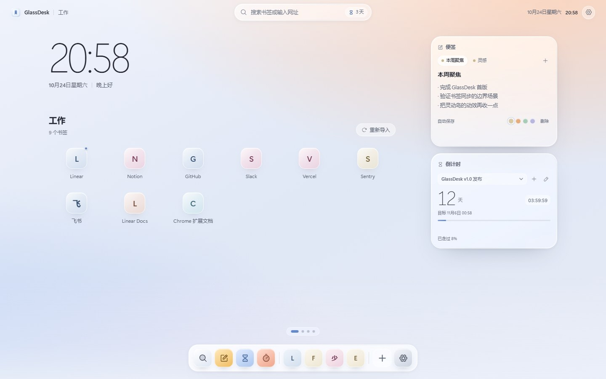
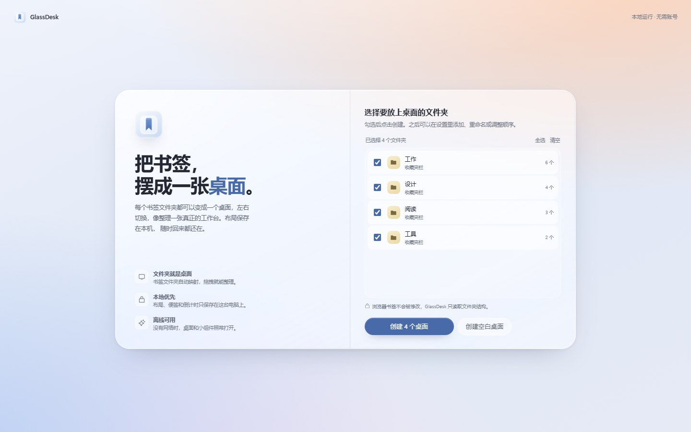
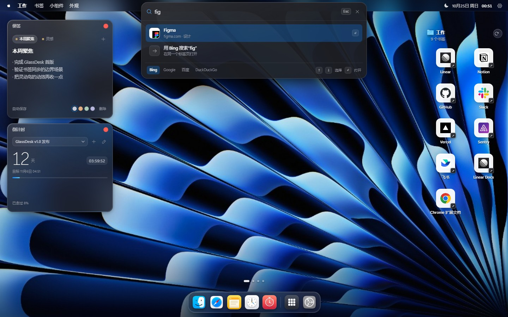
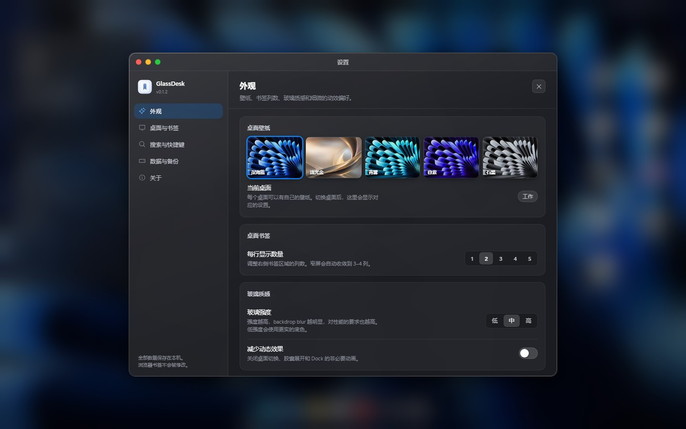

# GlassDesk


<p align="center">
    <a href="https://linux.do" alt="LINUX DO">
        </a>
</p>


深色 macOS Sonoma 风格的浏览器新标签页。它把书签文件夹映射成可以左右切换的桌面：左侧是深色玻璃小组件，右侧是书签应用图标，顶部是半透明菜单栏和居中的灵动岛搜索，底部是 Dock。支持完全本地的搜索。



## 功能

- **多桌面**：每个书签文件夹可以成为一个桌面。支持鼠标滚轮、触控板横向滑动、触屏左右滑动、`[` / `]`、桌面圆点或窄屏标签切换，也支持把书签拖到桌面圆点完成移动。内容需要滚动时滚轮先滚动页面，到达边界后再切换桌面。
- **书签布局**：读取浏览器书签树，保留文件夹层级；拖动排序、右键移动、固定到 Dock、复制链接。桌面布局与浏览器原始书签完全分离。
- **书签列数**：桌面右侧书签区域支持每行 1–5 个，可在设置的外观页调整；窄屏会自动收敛到 3–4 列。
- **书签同步**：`跟随更新` 模式监听新增、修改、移动、删除事件；`手动导入` 模式只在点击重新导入时更新。同步逻辑幂等，重复事件不会产生重复项。
- **深色玻璃视觉**：半透明菜单栏、居中灵动岛搜索、Dock、便签和倒计时卡片共享一套材质 Token。玻璃强度分低、中、高三档，减少动态效果可关闭非必要动画。
- **桌面小组件**：时钟、便签、倒计时、番茄钟、快速搜索。小组件可拖动、键盘微调位置、关闭后重新添加。
- **本地搜索**：搜索全部桌面的书签和桌面名称，也识别直接网址；支持 Bing、Google、百度、DuckDuckGo。
- **离线核心**：除搜索引擎跳转本身外，桌面、书签、便签、倒计时、番茄钟和搜索索引均可离线使用。扩展内的网站图标来自内置图标与浏览器本地 favicon 缓存；没有远程脚本、CDN 或账号。
- **数据安全**：`chrome.storage.local` 持久化、schema 版本迁移、迁移前备份、JSON 导出/导入、失效书签占位与清理。
- **第一帧**：静态启动画面先完成绘制，随后由 React 接管并加载本地布局和书签。



## 视觉参考

桌面布局和深色材质参考了 [qentrah/desktop-new-tab](https://github.com/qentrah/desktop-new-tab)（MIT）。壁纸和 Finder / Safari / 设置 / 文件夹图标素材来自该仓库（许可见 [第三方声明](docs/third-party-desktop-new-tab.md)）；网站图标优先使用仓库内置的常见站点图标，其余由 Chrome 本地 favicon 缓存提供。

## 快速开始

要求 Node.js 20.19 或更新版本，以及 Chrome 或 Microsoft Edge。

```bash
npm install
npm run build
```

1. 打开 `chrome://extensions`（Edge 为 `edge://extensions`）。
2. 打开“开发者模式”。
3. 选择“加载已解压的扩展程序”，指向本仓库的 `dist/` 目录。
4. 打开一个新标签页，按引导选择书签文件夹。

开发模式不需要加载扩展：

```bash
npm run dev
```

打开 `http://127.0.0.1:5173/src/newtab/`。开发环境没有扩展 API，会使用演示书签和 `localStorage` 适配层；演示站点使用本地图标，未知站点会回退到公开 favicon 服务。清除站点数据即可重新生成演示数据。

### 自动构建

推送到 `main`、发起 Pull Request 或手动运行 **Build extension** 工作流时，GitHub Actions 会执行类型检查、单元测试和生产构建，并把可加载的 `glassdesk-extension.zip`（含 SHA-256）上传为 artifact。

推送 `v*` 标签（例如 `v0.1.0`）会额外创建 GitHub Release，并附上同一个扩展压缩包：

```bash
git tag v0.2.0
git push origin v0.2.0
```

### 命令

| 命令 | 作用 |
| --- | --- |
| `npm run dev` | Vite 开发服务器和演示数据 |
| `npm run build` | 类型检查并生成 `dist/` 扩展包 |
| `npm run typecheck` | TypeScript 严格检查 |
| `npm test` | Vitest 单元测试 |
| `npm run test:e2e` | Playwright 页面端到端测试，默认使用本机 Edge |
| `npm run test:e2e:ext` | 构建并在 Edge 中加载 `dist/` 运行扩展端到端测试 |
| `npm run verify` | 类型检查、单元测试、页面端到端测试、生产构建 |
| `npm run icons` | 重新生成扩展图标 |

Playwright 默认使用 `msedge`。其他环境可以设置 `PLAYWRIGHT_CHANNEL=chrome`，或按 Playwright 文档安装 Chromium。扩展端到端测试需要 `GLASSDESK_EXT=1`，脚本 `test:e2e:ext` 已处理。





## 权限与隐私

| 权限 | 用途 |
| --- | --- |
| `bookmarks` | 读取书签树，监听书签变化 |
| `storage` | 保存布局、便签、倒计时和设置 |
| `favicon` | 从浏览器本地缓存读取网站图标 |

除 `favicon` 外不申请 `tabs`、`history`、`host_permissions`、`notifications`、`alarms`。扩展不读取网页内容，不注入页面，不执行远程代码。搜索查询只有在用户提交时才会发送给选中的搜索引擎。

网站图标优先使用仓库内置的常见站点图标，其余从 Chrome 本地 favicon 缓存读取；扩展构建不会为图标发起网络请求。开发预览没有扩展缓存，对未知站点会回退到公开 favicon 服务，最终仍会回退到首字母和确定性色相。

## 架构

```text
newtab (React)
  ├─ components/         菜单栏、灵动岛搜索、Dock、桌面、书签网格、小组件
  ├─ features/           书签映射、同步、搜索、布局、设置、引导
  ├─ stores/             轻量 useSyncExternalStore 状态
  ├─ services/           Chrome API 适配、存储、启动引导
  └─ styles/             Token、玻璃、布局、动画、组件样式
background/
  ├─ service-worker.ts   跟随书签事件写回布局
  └─ alarm-manager.ts    可选的系统提醒预留（首版不启用）
```

主要数据流：

1. 启动时先从 localStorage 镜像同步绘制上次布局，再读取 `chrome.storage.local` 和 `chrome.bookmarks`。
2. 浏览器书签是来源数据，桌面布局是独立配置。
3. 页面和 Service Worker 都可以处理书签事件，写入前读取最新存储并做合并，避免整份配置直接覆盖。
4. 所有存储写入按 key 串行读取、修改、写回，支持多个新标签页同时存在时的基本合并。

### 存储键

| Key | 内容 |
| --- | --- |
| `settings` | 外观、同步模式、默认搜索引擎、Dock 固定项、引导状态 |
| `desktop-layout` | 桌面、顺序、当前桌面、桌面指示点设置 |
| `bookmark-layout` | 从桌面布局派生的书签归属与顺序 |
| `widgets-layout` | 所有桌面小组件的位置、尺寸、层级和设置 |
| `notes` | 多张便签 |
| `countdowns` | 倒计时目标时间戳 |
| `pomodoro` | 番茄钟状态和绝对结束时间 |
| `bookmark-cache` | 书签标题/网址缓存，用于首屏和失效占位 |
| `storage-schema-version` | 当前 schema 版本 |
| `backup-pre-migration` | schema 升级前的原始数据备份 |

### 启动、迁移与恢复

- `primeWorkspaceFromMirror` 在 React 渲染前读取 localStorage 镜像，缩短首屏。
- `parsePersistedSnapshot` 对每一类数据做运行时校验和清洗；无效 enum、重复 id、错误类型会被降级，而不是让页面崩溃。
- 存储版本高于当前扩展版本时拒绝写入并显示错误页。
- 版本升级前先把原始数据写入 `backup-pre-migration`，迁移失败不会覆盖旧数据。
- 番茄钟和倒计时的完成判断只在存储快照 hydration 完成后执行，避免镜像首屏和异步数据覆盖之间的竞态。
- 番茄钟保存绝对 `endsAt`；倒计时保存绝对 `targetTime`，标签页关闭、浏览器重启或电脑休眠后重新计算剩余时间。

## 设计与性能取舍

- 视觉 Token 和玻璃参数位于 `src/styles/tokens.css`，起始值来自规格；玻璃使用半透明背景、单层 `backdrop-filter`、内高光边框和分层阴影近似。
- 不使用 Three.js、运行时 CSS-in-JS、远程字体或图标 CDN。图标来自本地打包的 Phosphor React，字体使用系统字体栈。
- 书签图标不使用 `backdrop-filter`，避免几十个模糊层同时合成；玻璃效果集中在卡片级表面。
- 桌面切换只改变 `transform` 和 `opacity`，时长 260ms；壁纸切换使用双图层透明度过渡。
- 没有持续运行的装饰动画。倒计时显示秒时会每秒更新自身组件，时钟按分钟级刷新。
- `prefers-reduced-motion` 和设置中的“减少动态效果”会关闭非必要动画；低玻璃强度会降低模糊半径并使用更实的底色。
- 桌面宽度小于 1040px 时，浮动圆点切换为横向桌面标签，小组件改为流式布局。
- 小组件拖拽只在指针释放时写入存储，拖动过程只改变 transform。

## 验证结果

在 2026-10-24 的本地环境（Windows 11 ARM64、Microsoft Edge、Playwright）完成：

- TypeScript 严格类型检查通过。
- Vitest：7 个测试文件，35 个单元测试全部通过。
- Playwright 页面测试：6 个通过，覆盖桌面切换、Spotlight 搜索、便签自动保存与重载、书签拖拽排序、右键菜单、倒计时、番茄钟恢复、设置持久化、备份下载、嵌套确认框和窄屏布局。
- Playwright 扩展测试：1 个通过，覆盖扩展加载、文件夹引导、MV3 Service Worker、书签事件增量同步、存储键完整性和 `chrome://newtab` 覆盖。测试过程中页面没有未捕获错误。
- 生产构建通过，`newtab.html`、`service-worker.js`、图标和 manifest 均位于 `dist/` 扩展包根目录。

复现：

```bash
npm run typecheck
npm test
npm run test:e2e
npm run test:e2e:ext
```

### 构建体积（生产构建，gzip）

| 资源 | 大小 |
| --- | --- |
| 新标签页入口 JS | 118.09 KB |
| 共享存储/迁移 chunk（首屏预加载） | 7.98 KB |
| 首屏 JS 合计 | 126.07 KB |
| CSS | 11.69 KB |
| HTML | 1.15 KB |
| Service Worker | 0.72 KB |

首屏 JS 建议预算为 150 KB gzip，本次构建为 126.07 KB gzip。首屏 JS + CSS + HTML 合计约 138.9 KB gzip。

### 本地性能采样（非正式基准）

测试条件：Headless Edge、1440×900、全新扩展 profile、4 个桌面 × 8 个书签、完成引导后重载 5 次。

- 首屏可见启动画面 FCP：452、456、1908、464、440 ms。中位数 456 ms，P75 464 ms；其中一次冷启动外点为 1908 ms。
- LCP：1268、1224、2808、1280、440 ms，中位数 1268 ms。
- 空闲 10 秒主线程 TaskDuration：0.121 s，约 1.21%；JS 堆 6.17 MB；741 个 DOM 节点；638 个事件监听器（桌面含一个正在运行的倒计时秒级刷新）。

这些数字来自软件渲染的 headless 环境和演示数据，只用于回归参考，不等同于目标硬件上的正式 P75。静态启动画面让“初始可见界面”在大多数采样中落在 500 ms 内，但完整交互桌面（LCP）仍然偏慢，需要继续优化。60 FPS 桌面切换、页面进程内存增量、Chrome 真机表现和浏览器缩放矩阵尚未做正式测量，因此不在本文档中宣称达标。

## 已知限制

- **网站图标**：新增 `favicon` 权限，优先本地内置图标，其次浏览器本地缓存；失效时回退到首字母和确定性色相。开发预览的未知站点会请求公开 favicon 服务。
- **系统通知**：倒计时和番茄钟只在页面内提示；`alarm-manager.ts` 已预留 `alarms` + `notifications` 的实现入口，但首版没有申请权限，因此关闭标签页后不会发送系统通知。
- **壁纸**：提供 5 套内置抽象/金属壁纸，不支持上传本地图片。上传会占用 `storage.local` 的 10 MB 配额，需要额外设计压缩与清理策略。
- **搜索引擎**：默认 Bing，可在设置中切换；默认值需要确认目标用户地区。
- **语言**：界面文案为中文，没有 i18n 框架。
- **多标签页**：写入尽可能按 key 合并，但复杂的并发编辑仍可能出现最后一次写入覆盖；这是 MV3 存储没有事务的固有限制。
- **备份导入**：书签按网址尽量重新匹配，原始文件夹 ID 在其他浏览器配置文件中可能失效，此时桌面会保留为自定义桌面。
- **范围外**：3D 桌面、物理模拟、云账号、跨设备同步、系统级 macOS 菜单栏、通知中心、网页音乐控制、天气和小组件市场均未实现。
- **小组件布局**：位置按像素保存，窗口缩小时会尽量向内收，但极端尺寸下需要滚动；窄屏使用流式布局。

